# Diagrama de clases UML del 21 Blackjack

El proyecto sigue el patrón **Modelo–Vista–Controlador**:

* **Modelo** (`com.example.blackjack.modelo`): cartas, mazo, manos y las reglas del juego.
* **Vista** (`vista/blackjack.fxml` + `vista/blackjack.css` + `vista/Dialogos`): la mesa principal
  y los cuatro cuadros de diálogo (apuesta, reglas, resultado y confirmación de cierre).
* **Controlador** (`controlador/BlackjackControlador`): atiende los eventos de la vista,
  pide operaciones al modelo y repinta la mesa con las respuestas.

```mermaid
classDiagram
    direction LR

    class BlackjackApp {
        +start(Stage)
    }
    class BlackjackControlador {
        -juego : Juego21
        -secuencia : Timeline
        -turnoComputadorEnCurso : boolean
        -saldoAntesDeApostar : int
        -initialize()
        -nuevaRonda()
        -iniciarRonda(apuesta)
        -pedirCarta()
        -plantarse()
        -verReglas()
        -cerrarJuego()
        +cierreConfirmado() boolean
        -validarApuesta(texto) String
        -despuesDeActuar()
        -jugarTurnoComputador()
        -revelarCartasDelComputador(cartas, cantidad)
        -terminarRonda()
        -datosDelResultado() DatosResultado
        -refrescar()
        -actualizarBotones()
        -dibujarCartas(zona, cartas)
        -vistaDeCarta(carta) ImageView
    }
    class Dialogos {
        +fichas(cantidad) String
        +pedirApuesta(padre, saldo, validar) Optional
        +mostrarReglas(padre)
        +mostrarResultado(padre, datos)
        +confirmarCierre(padre) boolean
    }
    class Tono {
        <<enumeration>>
        GANA
        PIERDE
        EMPATE
    }
    class DatosResultado {
        <<record>>
        tono, titulo, puntajeJugador,
        puntajeComputador, causa, resultado,
        etiquetaGanancia, ganancia, detalleGanancia
    }
    class Juego21 {
        +SALDO_INICIAL = 1000
        +APUESTA_MINIMA = 10
        -mazoFijo : Mazo
        -mazo : Mazo
        -manoJugador : Mano
        -manoComputador : Mano
        -saldo : int
        -apuesta : int
        -estado : Estado
        -resultado : Resultado
        +Juego21()
        ~Juego21(mazoFijo)
        +iniciarRonda(apuestaPedida)
        +pedirCarta()
        +plantarse()
        +validarApuesta(apuestaPedida) String
        +getSaldo() int
        +getApuesta() int
        +getEstado() Estado
        +getResultado() Resultado
        +getManoJugador() Mano
        +getManoComputador() Mano
        +getPuntajeJugador() int
        +getPuntajeComputador() int
        +jugadorTieneVeintiuno() boolean
        +jugadorTieneVeinteYMedio() boolean
        -turnoDeLaBanca()
        -resolver() Resultado
        -terminarRonda(resultado)
    }
    class Estado {
        <<enumeration>>
        SIN_RONDA
        TURNO_JUGADOR
        RONDA_TERMINADA
    }
    class Resultado {
        <<enumeration>>
        VICTORIA
        VICTORIA_BLACKJACK
        DERROTA
        EMPATE
    }
    class Mazo {
        +TOTAL_CARTAS = 52
        -cartas : Carta[52]
        -siguiente : int
        +Mazo()
        ~Mazo(ordenFijo)
        -llenar()
        +repartirCarta() Carta
        +mezclar()
        +tieneCartas() boolean
    }
    class Mano {
        -inicio : NodoCarta
        -cantidad : int
        +agregarCarta(carta)
        +getPrimera() NodoCarta
        +getCantidad() int
        +estaVacia() boolean
        +getPuntaje() int
        +contiene(figura) boolean
        +contieneValor(valor) boolean
        +contieneFigura() boolean
        +esBlackjack() boolean
        +esVeinteYMedio() boolean
    }
    class NodoCarta {
        -carta : Carta
        -siguiente : NodoCarta
        +NodoCarta(carta)
        +getCarta() Carta
        +getSiguiente() NodoCarta
        +setSiguiente(siguiente)
    }
    class Carta {
        -simbolo : Simbolo
        -rango : Rango
        +Carta(simbolo, rango)
        +getSimbolo() Simbolo
        +getRango() Rango
        +getValorBase() int
        +toString() String
    }
    class Simbolo {
        <<enumeration>>
        PICAS
        CORAZONES
        DIAMANTES
        TREBOLES
    }
    class Rango {
        <<enumeration>>
        AS, DOS, TRES, CUATRO, CINCO
        SEIS, SIETE, OCHO, NUEVE, DIEZ
        JOTA, REINA, REY
        -valorBase : int
        +getValorBase() int
        +esFigura() boolean
    }

    BlackjackApp --> BlackjackControlador : carga y consulta el cierre
    BlackjackControlador --> Juego21 : pide operaciones
    BlackjackControlador --> Dialogos : abre las ventanas de diálogo
    Dialogos --> Juego21 : constantes del modelo (saldo y apuesta mínima)
    Dialogos --> Tono
    Dialogos --> DatosResultado
    Juego21 *-- "2" Mano : jugador y computador
    Juego21 --> Mazo : mazo nuevo por ronda
    Juego21 --> Estado
    Juego21 --> Resultado
    Mano o-- NodoCarta : lista enlazada
    NodoCarta --> Carta
    Carta --> Simbolo
    Carta --> Rango
```

El diagrama se dibuja en IntelliJ o en <https://mermaid.live>:

