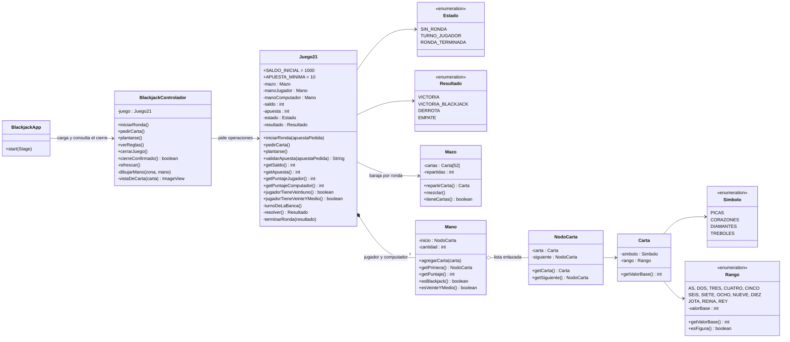

# Diagrama de clases UML del 21 Blackjack

El proyecto sigue el patrón **Modelo–Vista–Controlador**:

* **Modelo** (`com.example.blackjack.modelo`): cartas, mazo, manos y las reglas del juego.
* **Vista** (`vista/blackjack.fxml`): describe la mesa con JavaFX (zonas, puntajes, botones).
* **Controlador** (`controlador/BlackjackControlador`): atiende los eventos de la vista,
  pide operaciones al modelo y repinta la mesa con las respuestas.

El diagrama se dibuja en IntelliJ o en <https://mermaid.live>:

Detalles de diseño que valen la pena señalar:

* `Mazo` guarda las 52 cartas en un **arreglo**; `Mano` es una **lista enlazada** hecha en clase
  (`NodoCarta`), tal como pide el enunciado.
* `Juego21` administra el saldo, la apuesta vigente, el turno y el resultado: la vista solo muestra
  y el controlador solo traduce.
* Los constructores `Juego21(Mazo)` y `Mazo(Carta[])` son de acceso de paquete porque solo
  las pruebas los usan para fijar el orden de las cartas.
